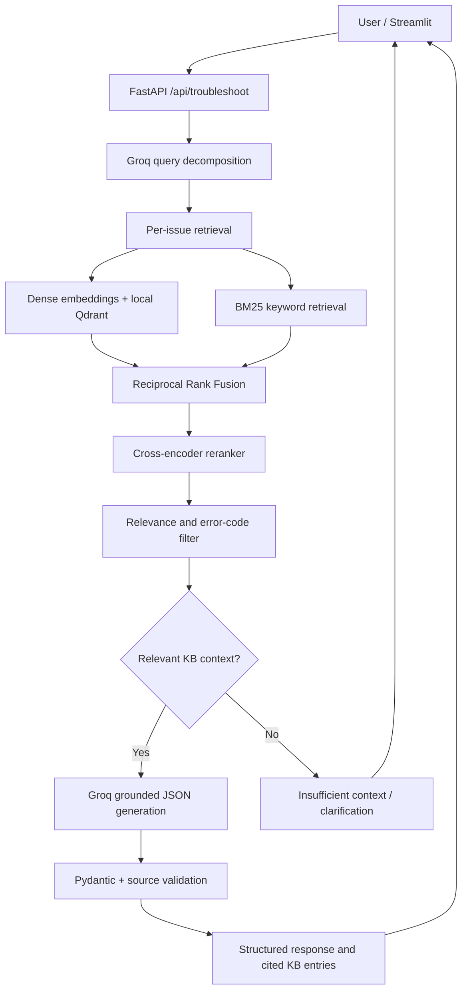

<div align="center">

# 🛠️ technoAssistant

### AI-Powered IT Troubleshooting with Hybrid Retrieval-Augmented Generation

**Turn technical incident reports into evidence-backed diagnostics, conditional resolutions, and escalation guidance.**

[Features](#-features) · [Architecture](#-architecture) · [Quick Start](#-quick-start) · [Evaluation](#-evaluation) · [Limitations](#-limitations)

     

</div>

> **Project status:** Working local prototype. Uses a **simulated** troubleshooting knowledge base; it does not connect to production infrastructure or execute remediation commands.

## ✨ Overview

**technoAssistant** is a knowledge-base-grounded IT support assistant designed for recurring L1/L2 troubleshooting scenarios. Users describe an issue in plain English, and the system retrieves relevant support runbooks before generating a structured response with possible causes, diagnostic checks, conditional resolutions, escalation ownership, and required incident details.

Instead of answering solely from a language model's general knowledge, technoAssistant uses a **hybrid RAG pipeline** with dense semantic search, BM25 keyword search, Reciprocal Rank Fusion (RRF), cross-encoder reranking, relevance filtering, and source validation.

## 🚀 Features

- **Natural-language issue reporting:** Describe symptoms, error messages, or affected services.
- **Hybrid retrieval:** Combines `all-MiniLM-L6-v2` embeddings and BM25 lexical matching.
- **Reciprocal Rank Fusion:** Merges dense and sparse retrieval rankings.
- **Cross-encoder reranking:** Reorders candidate runbooks using `cross-encoder/ms-marco-MiniLM-L-6-v2`.
- **Relevance and error-code checks:** Rejects unsupported matches, including incompatible explicit HTTP codes.
- **Multi-issue decomposition:** Separates distinct issues and supports partially answered requests.
- **Grounded response generation:** Groq-hosted LLM generates structured troubleshooting guidance using retrieved KB records.
- **Source traceability:** Displays the supporting knowledge-base entries and relevance scores.
- **Safe fallback behavior:** Requests clarification for vague reports and indicates when the KB is insufficient.
- **Evaluation:** DeepEval metrics and behavioral test cases for answer quality and unsupported scenarios.

## 🧠 Architecture



**Retrieval sequence:** Dense top-10 + BM25 top-10 → RRF top-10 → reranking → relevance filtering → up to 3 context records per issue → grounded generation.

**Knowledge base:** 30 simulated runbook entries across API, Database, Network, Infrastructure, DevOps, Application, and Authentication categories. Each record includes symptoms, error codes, possible causes, diagnostic checks, known resolutions, escalation conditions, and information to collect.

## 🧰 Tech Stack

| Layer | Technology |
|---|---|
| Interface | Streamlit |
| Backend | FastAPI, Pydantic |
| LLM inference | Groq API (`openai/gpt-oss-20b` configured in this prototype) |
| Dense embeddings | Sentence Transformers, `all-MiniLM-L6-v2` |
| Vector storage | Qdrant local embedded storage |
| Sparse retrieval | `rank-bm25` |
| Fusion | Reciprocal Rank Fusion (RRF) |
| Reranking | `cross-encoder/ms-marco-MiniLM-L-6-v2` |
| Evaluation | DeepEval, Groq-based judge, Pytest dependency |
| Language | Python |

## ⚡ Quick Start

### Prerequisites

- Python and `pip` (use a compatible version for the pinned/unpinned packages in `requirements.txt`)
- A [Groq API key](https://console.groq.com/keys)
- Windows PowerShell commands are shown below; adapt activation for macOS/Linux.

### 1. Clone the repository

```powershell
git clone https://github.com/YOUR_USERNAME/technoAssistant.git
cd technoAssistant
```

### 2. Create and activate the environment

```powershell
python -m venv venv
.\venv\Scripts\Activate.ps1
python -m pip install -r requirements.txt
```

### 3. Configure environment variables

Create a `.env` file **at the project root** (never commit this file):

```dotenv
GROQ_API_KEY=your_groq_api_key_here
GROQ_MODEL=openai/gpt-oss-20b
EVALUATION_MODEL=openai/gpt-oss-120b
```

Groq model availability varies by account and over time. Update the model identifiers if your account does not offer these models. `EVALUATION_MODEL` is only required when running DeepEval.

### 4. Initialize the local knowledge-base index

On a **fresh clone**, build the vector index once:

```powershell
python -m scripts.ingest
```

This reads `data/knowledge_base.csv` and creates local `qdrant_storage/`. **You do not need to re-ingest on every startup.** Re-run ingestion when the KB changes, after stopping the backend.

### 5. Start the API (Terminal 1)

```powershell
python -m uvicorn backend.main:app --host 127.0.0.1 --port 8000
```

API documentation: **http://127.0.0.1:8000/docs**  
Health endpoint: **http://127.0.0.1:8000/health**

### 6. Start the interface (Terminal 2)

```powershell
.\venv\Scripts\Activate.ps1
python -m streamlit run frontend/app.py
```

Open **http://localhost:8501**.

### Restarting later

Once the index and `.env` exist, start **only the API and Streamlit** (steps 5 and 6). Stop each with `Ctrl+C`.

> **Embedded Qdrant concurrency:** Do not run `scripts.ingest`, `backend.rag.pipeline`, or `evaluation.evaluate_rag` while FastAPI is using the same `qdrant_storage` folder. Stop FastAPI first, or use a Qdrant server for multi-process access.

## 💬 Example Queries

```text
Payment API is returning HTTP 500
```

```text
Payment transactions are failing with an internal server error
```

```text
Payment API HTTP 500 and HTTP 505
```

```text
Something is not working
```

Depending on the query, technoAssistant returns supported guidance, a partially supported result, an insufficient-context response, or a request for clarification. It does not claim to have executed checks or fixes.

## 🗂️ Project Structure

```text
technoAssistant/
├── backend/
│   ├── main.py                  # FastAPI application
│   ├── config.py                # Environment and Groq configuration
│   ├── schemas.py               # API request/response models
│   ├── database/
│   │   └── vector_store.py      # Embedded Qdrant connection
│   └── rag/
│       ├── data_loader.py
│       ├── chunking.py
│       ├── embeddings.py
│       ├── dense_retriever.py
│       ├── sparse_retriever.py
│       ├── rrf.py
│       ├── hybrid_search.py
│       ├── reranker.py
│       ├── relevance_filter.py
│       ├── context_selector.py
│       ├── query_decomposer.py
│       ├── multi_issue_retriever.py
│       ├── generator.py
│       ├── validator.py
│       └── pipeline.py
├── frontend/
│   └── app.py                   # Streamlit chat UI
├── data/
│   └── knowledge_base.csv       # Simulated support runbooks
├── scripts/
│   └── ingest.py                # Build local vector index
├── evaluation/
│   ├── dataset.json
│   ├── judge.py
│   └── evaluate_rag.py
├── requirements.txt
├── .gitignore
└── README.md
```

Local-only/generated files such as `.env`, `venv/`, `qdrant_storage/`, and evaluation results should not be committed unless intentionally sanitized.

## 📊 Evaluation

An initial **six-case smoke test** covered direct and paraphrased Payment API queries, an unsupported HTTP code, vague input, and mixed supported/unsupported codes.

| Measure | Observed result | Scope |
|---|---:|---|
| Expected response-status accuracy | **6/6 (100%)** | Six smoke-test cases |
| Faithfulness | **1.000** | Three supported Payment API cases |
| Answer Relevancy | **1.000** | Three supported Payment API cases |
| Contextual Precision | **1.000** | Three supported Payment API cases |
| Contextual Recall | **1.000** | Three supported Payment API cases |
| Contextual Relevancy | **1.000** | Three supported Payment API cases |
| Average pipeline latency | **2.13 seconds** | Reported smoke-test run; excludes LLM-as-judge time |

**Interpretation:** These are *initial smoke-test results*, not a claim of 100% accuracy across all 30 KB entries or production incidents. The five DeepEval metrics were run on three related supported queries using a Groq-hosted LLM judge. Broader coverage, independent judging, retrieval-stage comparisons, and repeated runs are future evaluation work.

To rerun the evaluation (with FastAPI stopped):

```powershell
python -m evaluation.judge
python -m evaluation.evaluate_rag
```

The evaluation script writes results to `evaluation/results.json`.

## 🔐 Safety & Privacy

- Uses **simulated** knowledge-base entries; not a live incident-response system.
- Does not run commands, change infrastructure, or claim a remediation was executed.
- Returns conditional troubleshooting suggestions and explicit escalation guidance.
- Keep API keys in `.env`, not in source code or screenshots.
- Remove credentials, tokens, customer information, and sensitive logs before submitting incident descriptions to any remote LLM API.
- Groq inference sends relevant prompts and selected KB context to an external provider; evaluate organizational data policies before real-world use.

## ⚠️ Limitations

- Small, simulated knowledge base; coverage is not comprehensive.
- LLM decomposition may require clarification for ambiguous or unusual error-code formats.
- Relevance threshold is provisional and needs calibration on a larger labeled dataset.
- Conversation history is displayed in the UI but is **not** used as multi-turn conversational memory by the retrieval pipeline.
- Embedded Qdrant is single-process storage; not designed for concurrent server workers.
- Evaluation coverage is limited and model-based scores can vary between runs.
- Local demo only; production authentication, observability, rate limiting, and deployment hardening are not implemented.

## 🗺️ Roadmap

- [ ] Expand evaluation cases across all seven KB categories.
- [ ] Compare dense-only, hybrid RRF, and reranked retrieval (e.g., Hit@3/MRR).
- [ ] Calibrate relevance filtering against labeled positive/negative queries.
- [ ] Add automated unit and integration tests.
- [ ] Add optional conversational follow-up support.
- [ ] Add safe production deployment and monitoring patterns.

## 👩‍💻 Author

**Sakshi Ippe**  
Software Engineering · Generative AI · Retrieval-Augmented Generation

---

<div align="center">

**Built to make IT troubleshooting more structured, traceable, and knowledge-driven.**

</div>
